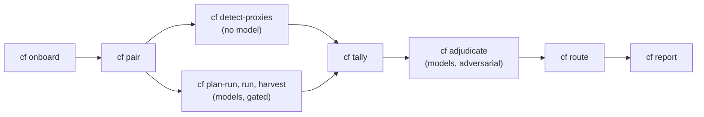

# Running an audit

An audit checks a companion against the sources it formalizes. It finds the
declarations that are provable but are not the source's statement (an extra
hypothesis, a missing quantifier, a vacuous theorem, a proxy definition) and the
items nobody formalized, and drives them through an adversarial review before
anyone is told about them. It reports findings only: it stops at challenged
findings, routed to each repository's owner, and a report whose every number is
recomputed from the corpus. Fix-PR authoring, merge review and camera-ready audits
are out of scope, with the extension points left clean.



Agents' findings pass a gate they cannot edit: a quote must occur in the source text, and
in an attack run a CONTENT or VACUITY finding must name a witness. The gate checks that one
is there, and reviewers judge it.

[SKILL.md](../SKILL.md) is the same program written for an agent, with the command
index and the hard rules. [The workspace](workspace.md) describes the directory
these commands write.

**Contents**: start a workspace · what onboarding prints · the rest of the program ·
a fleet on a host · a local fleet · findings from before this skill · challenge,
route, report · the synthetic demonstration · when discovery cannot decide

The shell blocks read shell variables, so they paste as they are once the paths are
set.

## Start a workspace

```sh
COMPANION=/path/to/companion
NAME=$(basename "$COMPANION" | tr 'A-Z_ ' 'a-z--')
WORKSPACE=~/audit-workspace
cf init "$WORKSPACE" && cd "$WORKSPACE" && cf onboard "$COMPANION"
```

That is the whole of stage 0 for one companion. No `--book`, no `--pdf`, no
`--offset`, no `--errata-url`. A companion is named after its repository directory,
lower-cased with `_` and spaces turned into `-` (`measure_theory` becomes
`measure-theory`), unless `cf onboard` is given `--name`, and later commands take that
name.

## What onboarding prints

This transcript is an **abridged illustration**, not a promise: one real run,
captured 2026-09-21 against `tao-measure-lean` at `250b856`, with the paths replaced by
placeholders and the checks that passed quietly cut. Every count in it belongs to
that commit, so another checkout prints other numbers, and that is drift, not
breakage. The transcript you can reproduce is `bash tests/e2e/synthetic.sh`, which
builds its own booklet and two companions of it and checks 27 artifacts against
pinned figures.

```text
repo      : <tao-measure-lean>
adapter   : docstring_tags                     confidence 0.93   (42 of 44 sampled
            .lean files with a docstring open one with a book tag (110 carry no docstring))

sources discovered
  tao-measure-2011-draft         sha 62d95658…  registry: skill (confirmed)
      from     graph.json#metadata.sources, CLAUDE.md#sha256_prefix,
               sources/tao-measure-theory.pdf, README.md#links
      pdf      <companions>/tao-measure-lean/sources/tao-measure-theory.pdf   found in: repo_declared
      offset   16                                 confidence 0.996  (running_head_mode)
  tao-measure-gsm126-published   sha 64498329…  registry: skill (confirmed)
      from     formalization.yaml#sources, CLAUDE.md#sha256_prefix, …
      pdf      <companions>/measure_theory/.lake/official-pdf/gsm-126-tao5-measure-book.pdf
      offset   16                                 confidence 0.996  (running_head_mode)
      errata   https://terrytao.wordpress.com/books/an-introduction-to-measure-theory/
               confidence 1.00

ok   prepared  sources/tao-measure-2011-draft/   text 265 pages, 441 items, offset 16
ok   prepared  sources/tao-measure-gsm126-published/   text 265 pages, 442 items, offset 16
ok   errata    …  HTTP 200  <n> entries  (registry, confidence 1.00)
ok   extracted companions/tao-measure-lean/statements.jsonl   1131 rows
ok   scope     chapters [1, 2]   from the items the companions actually tag

anchor edition
  tao-measure-gsm126-published                 confidence 0.96
      anchor agreement  tao-measure-2011-draft             0.68 (202 ok / 95 mismatched)
      anchor agreement  tao-measure-gsm126-published       0.91 (271 ok / 27 mismatched)
      reason: anchor_agreement
      corroborated by prose: "Book-page anchors in docstrings follow the PUBLISHED pagination…"
  the repo BUNDLES tao-measure-2011-draft but does not anchor to it -> bundled_sources
```

Onboarding scored the repository's own page anchors against both editions, so with
no flag it found what the repository does: it **ships** the 2011 draft and
**anchors** to the published edition. The sentence in its `CLAUDE.md` only
corroborated that result.

## The rest of the program

Onboard the second companion of the same book. A differential is possible exactly
where two companions' source lists overlap.

```sh
OTHER_COMPANION=/path/to/other/companion
cf onboard "$OTHER_COMPANION"
```

Then edit `companions/*/conventions.md` and have each owner confirm it. That list
separates CONVENTION from CONTENT, and an unconfirmed list is the largest single
source of false positives, so `cf plan-run` refuses a companion whose file carries
no `confirmed_by:` stamp. `--conventions-unconfirmed` overrides that, and
`run.yaml` records it.

The map is available at any point:

```sh
cf status
cf sources list
```

`cf status` prints the sources table, the one line saying where a differential is
possible, each companion's `state.json`, any source nobody has confirmed, and
whether the workspace repository has acquired a remote. It prints nothing it did
not read from a file, so a missing number means a stage has not run.

Pairing and the free findings come next:

```sh
cf pair && cf detect-proxies "$NAME"
```

`cf pair` writes one `pairs/<source_id>/` tree per source, shared or not: a source one
companion audits still gets its coverage, anchors and targets.
`cf detect-proxies` runs the coverage and proxy detectors with no model and no
cost, and publishes its rows into `corpus/detect-<name>-cheap/` behind the
`mechanical` gate. Without a stage table for the source it reports coverage, warns
that the body-proxy scan was skipped, and says an empty candidate list means nothing
was scanned.

Findings are then counted, routed and reported. A companion with no model-free findings
leaves `corpus/` empty, and `cf tally` then stops with
`no harvested runs found in corpus/`, so the chain below ends there. `cf route` and
`cf report` still run on their own. With no rows, `cf route` prints
`<name>: 0 row(s) / 0 item(s) — CHALLENGED`, which says only that nothing is unchallenged.

```sh
cf tally --union &&
  cf route &&
  cf report
```

## A fleet on a host

Server fleets need an allowlisted host in `workspace.yaml`, recorded consent and a spend
ceiling: `--max-cost`, `budget.max_cost_usd` in `workspace.yaml`, or `--no-budget-cap` to
acknowledge running without one. `cf run` is a dry run until `--execute`, and prints the
plan and what it would transfer.

```sh
RUN_HOST=examplebox
RUN=attack-vac-1
MAX_COST=25
cf plan-run --preset attack-vac --companion "$NAME" --run-id "$RUN" \
    --host "$RUN_HOST" --i-have-consent &&
  cf run "$RUN" --host "$RUN_HOST" --i-have-consent --max-cost "$MAX_COST"
```

`attack-vac` plans a Codex model, so the host needs that agent under `agentbox`, and
`cf plan-run` prints the model. `attack-hunt` runs on Claude.

With `--execute` it goes as far as the 1/1 smoke test. Workers on the host read the
companion and the source text, and the plan says when either stays behind: add
`--include-sources` and `--include-source-text` the first time, unless the host already
holds them. Once a person has watched one task through worker, gate, reviewer and merge,
`--stage raise --smoke-verified` raises the limits.
[The server runbook](../references/runbook-server.md) has the stages and the failure modes.

```sh
cf run "$RUN" --host "$RUN_HOST" --i-have-consent --max-cost "$MAX_COST" --execute
```

```sh
cf run "$RUN" --host "$RUN_HOST" --i-have-consent --max-cost "$MAX_COST" \
    --stage raise --smoke-verified --execute
```

`cf harvest` brings the findings back from the host, and without `--execute` it only prints
the commands it would run.

```sh
cf harvest "$RUN" --execute &&
  cf tally --union --agreed
```

The findings gate runs by default in `cf harvest` and `cf import-corpus`. An import
of a directory this workspace never planned has no gate config to build unless you
name a `--preset` or a `--gate-config`: it then records `gate: null`, warns, and
`cf tally` repeats that warning for every run it counts.

To price a run, add `--transcripts <path>` to `cf harvest`, with the agents' own
transcripts or a `cf cost --export` file made on the host. `RECEIPT.json` then
carries the tokens by model and the dollars, and `cf tally` and `cf report` print
the cost per task.

## A local fleet

With no allowlisted host, omit `--host`: it defaults to `local`. `cf plan-run` then
prints a note when the plan is above `local_fleet_max_items`, which defaults to 100
(the two worked companions are 506 and 178 items), so either raise that key in
`workspace.yaml` or accept `cf run <id> --local --force` and a resume.

```sh
RUN=attack-vac-1
cf plan-run --preset attack-vac --companion "$NAME" --run-id "$RUN" &&
  cf run "$RUN" --local
```

`cf` cannot start a Workflow itself, so `cf run --local` stages the run and prints the
script and the arguments to launch from a Claude Code session. When the Workflow has
finished, harvest its `wf_*` directory, which sits under
`~/.claude/projects/<project>/<session-id>/subagents/workflows/`:

```sh
WORKFLOW_DIR=/path/to/workflow-directory
cf harvest "$RUN" --journal "$WORKFLOW_DIR"
```

`SKILL.md`'s Workflow stages table and `references/workflow-patterns.md` section 6
have the detail.

## Findings from before this skill

`--repo-map` says which companion their repository names are. The union key holds
the repository, so an unmapped import joins nothing this workspace runs.

```sh
FINDINGS=/path/to/findings
cf import-corpus --run-id findings-diff --from "$FINDINGS" --preset differential-legacy \
    --repo-map ours="$NAME"
```

An attack corpus goes in under its own preset, `--mode attack --preset attack-legacy`
(`tests/e2e/multisource.sh`). The two legacy presets gate different things:
`differential-legacy` keeps PAGE_ANCHOR in its kinds, and `attack-legacy` carries the
witness `convert_v1` lifted out of `reasoning`.

Rows judged against another edition say so. The first campaign's batch-1 rows were
judged against the 2011 draft:

```sh
EDITION_SHA=the-full-sha256-of-that-edition
cf import-corpus --run-id batch1 --from "$FINDINGS" --preset differential-legacy \
    --source tao-measure-2011-draft --source-sha "$EDITION_SHA" \
    --allow-edition-mismatch
```

## Challenge, route, report

```sh
cf adjudicate --companion "$NAME"
```

With no other flags, `cf adjudicate` prints how many rows are still unchallenged and
the next command. `--emit-args` writes the Workflow arguments and prints the
invocation to run from a Claude Code session, and `--transcribe` turns the result
into ledger rows:

```sh
RESULT=/path/to/adjudicate.result.json
cf adjudicate --companion "$NAME" --transcribe "$RESULT" --from adjudicate &&
  cf route &&
  cf report
```

`cf route` writes per-owner files and keeps UNCHALLENGED on any row no adversarial
pass has seen. `cf report` recomputes every number from the corpus and writes the
arguments for the claims-verification Workflow. `SKILL.md`, "Workflow stages", has
the shape all five such stages share, and what to do when the Workflow tool is not
available.

## The synthetic demonstration

`bash tests/e2e/synthetic.sh` needs no private checkout, and it is what CI runs. It
generates a public-domain booklet and two synthetic Lean companions of it carrying
eight planted defects, onboards them with nothing about the booklet typed in, runs the
model-free detectors and scores them against `tests/e2e/answer-key.json`. Python 3.11+,
git and poppler's `pdftotext` are all it needs. Without `pdftotext` it prints SKIP and
exits 0, unless `CF_REQUIRE_POPPLER=1` makes that a failure, as CI does.

Its last line names the workspace it left. `cf` runs in that workspace, so to rerun the
scoring from there, name the fixture files by absolute path:

```sh
SKILL=/path/to/formal-companion
cf detect-proxies notes-a --stages "$SKILL/tests/e2e/stages.anonymous-elementary-sets.json"
cf detect-proxies notes-b --stages "$SKILL/tests/e2e/stages.anonymous-elementary-sets.json"
cf score --run detect-notes-a-cheap --run detect-notes-b-cheap \
    --run anchor-check-anonymous-elementary-sets \
    --answer-key "$SKILL/tests/e2e/answer-key.json"
```

The recorded score for the mechanical tier is **precision 1.00, recall 0.50, F1
0.6667**. It finds all 4 defects of the 3 kinds it can see (PROXY 2, COVERAGE 1,
PAGE_ANCHOR 1) and none of the 4 defects of the 2 kinds it cannot (CONTENT 3,
VACUITY 1), which is the free detector's recall ceiling. A defect nobody raised
leaves no artifact behind, so recall needs a fixture whose defects are known. That
makes this the only quality number in the repository a stranger can reproduce.
`tests/e2e/synthetic.sh` and `tests/test_rf_benchmark.py` each recompute it rather
than trusting it.

`tests/e2e/multisource.sh` adds the half that onboards the two Tao companions. It
needs their checkouts, named by `CF_TML` and `CF_MT`, and with neither set it exits
2 and says what to set.

## When discovery cannot decide

Discovery stops and names the override rather than guessing.

| Situation | Override |
|---|---|
| The inferred offset's confidence was below 0.9 | `cf sources set <id> offset=16` |
| You want to pin the scope instead of deriving it | `cf sources set <id> chapters=1,2` |
| The book numbers deeper than its headings showed | `cf sources set <id> numbering=3,4` |
| The item table is under 0.6 complete and you checked why | `cf sources set <id> completeness_ok=true` |
| You checked a discovered entry | `cf sources set <id> confirmed=true` |
| Two editions scored too close to call | `cf onboard <repo> --anchor-source <id>` |
| No adapter scored above 0.5 | `cf onboard <repo> --adapter docstring_tags` |
| The repository names no source, or not this one | `cf onboard <repo> --source <file>` |
| The repository names a source it does not identify | `cf sources add <source> --for <companion>` |
| A source should not be here | `cf sources remove <id>` |
| The author's own site may be fetched from, license permitting | `cf onboard <repo> --download` |

Every override stamps its own trace: `offset_method: manual`, `scope_method: manual`,
`numbering_method: manual`, `completeness_method: manual`, and `confirmed: false`
until a person says otherwise. `references/onboarding-contract.md` says what a
repository must expose for discovery to succeed.
